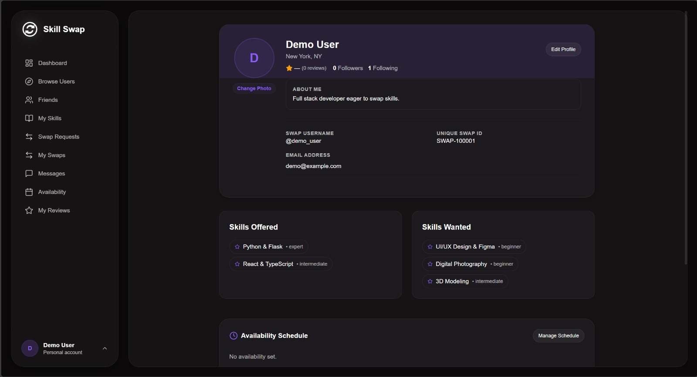
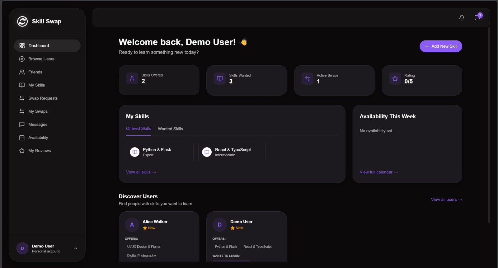
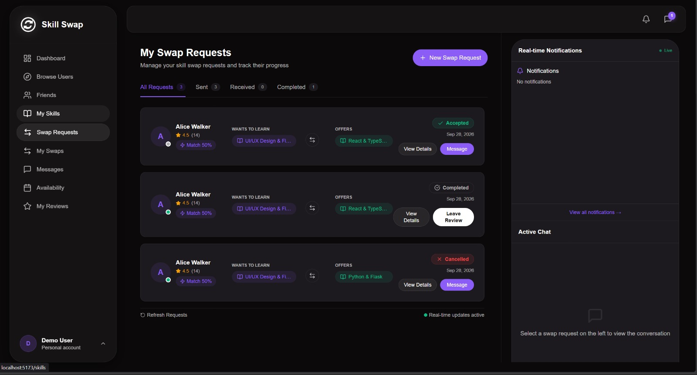
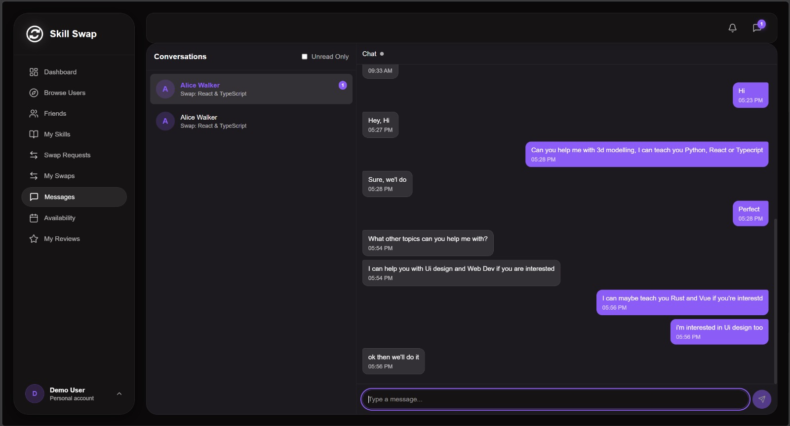
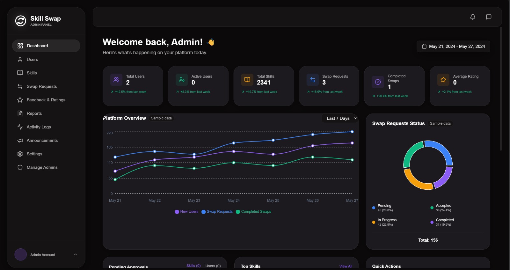

<div align="center">
  
  <h1>Skill Swap</h1>
  <p>An enterprise-grade peer-to-peer knowledge exchange and skill bartering platform featuring automated compatibility scoring and real-time collaboration.</p>

  [](https://opensource.org/licenses/MIT)
  [](https://www.python.org/)
  [](https://flask.palletsprojects.com/)
  [](https://react.dev/)
  [](https://www.typescriptlang.org/)
  [](https://tailwindcss.com/)
  [](https://www.postgresql.org/)
  [](https://socket.io/)
  [](https://github.com/Kxhor/Skill-swap)
</div>

***

## 1. Executive Summary

Skill Swap is a production-ready, full-stack web application designed to facilitate decentralized skill sharing between peers. Rather than relying on monetary transactions, members exchange domain expertise in a structured barter model. Users offer specialized skills from their profile and discover complementary partners who possess the capabilities they want to learn.

The platform provides intelligent compatibility scoring through Google Gemini, bidirectional swap negotiation workflows, WebSocket-driven instant messaging, session scheduling, community feedback loops, and an administrative control panel for moderation and platform telemetry.

***

## 2. Architecture Overview

The platform uses a decoupled, event-driven client-server architecture built for high availability and low latency:

```text
+-----------------------------------------------------------------+
|                     Client Tier (React SPA)                    |
|  - Framework: React 18, Vite, TypeScript, React Router DOM      |
|  - State & Caching: TanStack Query (v5)                         |
|  - UI & Primitives: Tailwind CSS v4, Radix UI, Lucide Icons     |
+-------------------------------+---------------------------------+
                                |
               HTTP REST APIs   |   WebSocket Channels
               (JSON Payloads)  |   (Socket.IO Protocol)
                                |
+-------------------------------+---------------------------------+
|                     Application API Gateway                     |
|  - Engine: Python Flask, Gevent WSGI, Flask-SocketIO            |
|  - Security: Flask-WTF (CSRF), Flask-Limiter, Bleach Sanitizer  |
|  - Identity: Flask-Login, Session Cookies, Bcrypt Hashes        |
+-------------------------------+---------------------------------+
                                |
         +----------------------+----------------------+
         |                                             |
+--------+--------+                           +--------+--------+
| Database Tier   |                           | Cloud Services  |
| - PostgreSQL    |                           | - Google Gemini |
| - SQLAlchemy 2  |                           | - Cloudinary    |
| - Alembic       |                           +-----------------+
+-----------------+
```

### Technology Matrix

| Layer | Technology | Primary Role |
| :--- | :--- | :--- |
| **Frontend Core** | React 18, TypeScript, Vite | Single-page application runtime and type-safe components |
| **State & Data Fetching** | TanStack React Query (v5) | Server-state caching, optimistic updates, and cache invalidation |
| **Styling & Design System** | Tailwind CSS v4, Radix UI, Lucide Icons | Accessible primitives, dark theme, and glassmorphism styling |
| **Backend Core** | Python 3.10+, Flask, Flask-SQLAlchemy | RESTful API controllers, business logic, and ORM abstractions |
| **Real-Time Communication** | Flask-SocketIO, Socket.IO Client, Gevent | Instant messaging, active typing indicators, and presence tracking |
| **Security & Hardening** | Flask-WTF, Flask-Limiter, Bleach, Bcrypt | CSRF token validation, rate throttling, and payload sanitization |
| **Database & Migrations** | PostgreSQL, Alembic | Relational storage, referential integrity, and schema versioning |
| **Artificial Intelligence** | Google Gemini API | Automated semantic skill matching and partner compatibility |
| **Asset Storage** | Cloudinary | Cloud-hosted user profile imagery and media delivery |

***

## 3. Core Features

### AI Compatibility Matching (Google Gemini)
Profile attributes and skill sets are processed through Google Gemini to generate multidimensional compatibility scores. Users receive quantified compatibility ratings and analytical rationales highlighting shared strengths.

### Real-Time Socket.IO Communication
WebSocket channels enable instant chat sessions between verified swap participants. Features include real-time message delivery, live typing state broadcasts, online presence indicators, and unread notification counts.

### Enterprise Authentication and Session Security
The platform utilizes stateful session authentication managed by Flask-Login with salted Bcrypt password hashing. All mutating operations enforce double-submit CSRF token validation. Endpoint access is guarded by role-based authorization tiers.

### Bidirectional Swap State Machine
Proposals follow an explicit lifecycle state transition model:
* `pending`: Proposal awaiting partner review.
* `accepted`: Swap terms confirmed; unlocks real-time messaging and scheduling.
* `rejected`: Proposal declined by the receiver.
* `cancelled`: Proposal rescinded by the sender prior to acceptance.
* `completed`: Mutual confirmation of session fulfillment, unlocking review submission.

### Dual Dashboard Architecture
* **User Dashboard:** Centralized operations center for monitoring active swaps, responding to incoming partner requests, reviewing scheduled learning sessions, and tracking skill progression.
* **Administrative Console:** Dedicated administration portal (`/admin`) providing system telemetry, user moderation, ban enforcement, and platform skill catalog management.

***

## 4. Screenshot Showcase

### Dashboard and User Profile

*Personal profile view displaying offered skills, wanted competencies, availability windows, and community reputation statistics.*

### Partner Discovery and Compatibility Scoring

*Peer discovery screen showing semantic skill overlap, AI compatibility indicators, and direct swap proposal initiation.*

### Active Swap Request Pipeline

*Structured pipeline showing incoming, outgoing, active, and historical skill exchange contracts across lifecycle stages.*

### Real-Time Chat and Negotiation

*Socket.IO messaging interface with typing notifications, session synchronization, and contextual swap details.*

### Administrative Operations Center

*Telemetry and moderation hub displaying system-wide swap volume, active account controls, and user moderation tables.*

***

## 5. Local Development Setup

Follow these instructions to configure and execute the application in your local environment.

### System Prerequisites
* **Node.js** (v18.0.0 or higher) and npm (v9.0.0 or higher)
* **Python** (v3.10.0 or higher)
* **Git** (v2.30.0 or higher)

### Step 1: Clone the Repository

```bash
git clone https://github.com/Kxhor/Skill-swap.git
cd Skill-swap
```

### Step 2: Backend Configuration and Startup

1. Navigate to the backend directory:
   ```bash
   cd backend
   ```

2. Initialize a Python virtual environment:
   * **Linux / macOS:**
     ```bash
     python3 -m venv .venv
     source .venv/bin/activate
     ```
   * **Windows (PowerShell):**
     ```powershell
     python -m venv .venv
     .venv\Scripts\Activate.ps1
     ```

3. Install project dependencies:
   ```bash
   pip install -r requirements.txt
   ```

4. Populate your local environment variables:
   ```bash
   cp .env.example .env
   ```
   *Note: For local testing, SQLite is supported automatically when `DATABASE_URL` is omitted.*

5. Execute database schema migrations:
   ```bash
   python -m flask db upgrade
   ```

6. Start the backend API service:
   ```bash
   python run.py
   ```
   The backend API will listen on `http://127.0.0.1:5005`.

### Step 3: Frontend Configuration and Startup

1. Open a new terminal session and navigate to the frontend directory:
   ```bash
   cd frontend
   ```

2. Install Node dependencies:
   ```bash
   npm install
   ```

3. Launch the Vite development server:
   ```bash
   npm run dev
   ```
   The application interface will be available at `http://localhost:5173`.

***

## 6. Environment Configuration

Create a `.env` file inside the `backend/` directory based on the following template:

| Variable Name | Required | Default / Example Value | Description |
| :--- | :--- | :--- | :--- |
| `FLASK_ENV` | No | `development` | Runtime environment mode (`development`, `production`). |
| `SECRET_KEY` | Yes | `generate-a-secure-random-key` | Cryptographic secret for signing session cookies and tokens. |
| `DATABASE_URL` | No | `sqlite:///instance/skillswap.db` | PostgreSQL connection string or SQLite fallback. |
| `CLOUDINARY_CLOUD_NAME` | No | `your-cloud-name` | Cloudinary account identifier for media storage. |
| `CLOUDINARY_API_KEY` | No | `your-api-key` | Public API credential for Cloudinary. |
| `CLOUDINARY_API_SECRET` | No | `your-api-secret` | Private API credential for Cloudinary. |
| `GEMINI_API_KEY` | No | `your-gemini-api-key` | Google Gemini API key for compatibility scoring. |
| `CORS_ALLOWED_ORIGINS` | No | `http://localhost:5173` | Comma-delimited list of authorized cross-origin domains. |

***

## 7. Pre-Configured Test Accounts

The local development seed provides pre-configured user credentials for end-to-end evaluation:

| Account Type | Email Address | Password | Role & Functional Purpose |
| :--- | :--- | :--- | :--- |
| **Primary Member** | `demo@example.com` | `password123` | Tests profile management and outgoing swap creation. |
| **Partner Member** | `alice@example.com` | `password123` | Tests reciprocal proposal approval, real-time chat, and reviews. |
| **Platform Administrator** | `admin@example.com` | `adminpassword123` | Accesses the `/admin` moderation and telemetry console. |

***

## 8. Directory Layout

```text
Skill-swap/
├── backend/
│   ├── app/
│   │   ├── models/            # SQLAlchemy database entities
│   │   ├── routes/            # REST API blueprint controllers
│   │   ├── utils/             # Gemini matching, sanitization, validation
│   │   ├── extensions.py      # Extension instances (db, limiter, socketio)
│   │   └── socket_events.py   # WebSocket event handlers
│   ├── migrations/            # Alembic database migration scripts
│   ├── tests/                 # Automated pytest test suite
│   ├── .env.example           # Backend environment variable template
│   ├── requirements.txt       # Python package dependencies
│   ├── run.py                 # Local development entry point
│   └── wsgi.py                # Production WSGI application wrapper
├── frontend/
│   ├── public/                # Static assets and icons
│   ├── src/
│   │   ├── components/        # Reusable UI widgets and layout shells
│   │   ├── context/           # React Context providers (Auth, Socket)
│   │   ├── hooks/             # Custom TanStack Query hooks
│   │   ├── lib/               # API client, utilities, and constants
│   │   └── pages/             # Application route views
│   ├── package.json           # Node.js dependencies and script definitions
│   └── vite.config.ts         # Vite build configuration and proxy setup
├── screenshots/               # Visual asset showcase for documentation
├── .gitignore                 # Version control exclusions
└── README.md                  # Project documentation
```

***

## 9. Quality Assurance and Testing

The repository includes a comprehensive test suite to prevent regressions across security boundaries, swap lifecycles, and data integrity.

### Execute Backend Tests

```bash
cd backend
pytest
```
*Result: 142 integration tests validating authorization, rate limits, WebSocket protocols, and lifecycle constraints.*

### Execute Frontend Production Build

```bash
cd frontend
npm run build
```
*Result: Enforces strict TypeScript compilation and builds minified production assets with zero diagnostics errors.*

***

## 10. Security Controls

* **Password Security:** Salted password hashing via Bcrypt; plaintext passwords are never persisted or logged.
* **CSRF Mitigation:** Double-submit cookie verification via Flask-WTF on all mutating HTTP methods (`POST`, `PUT`, `DELETE`).
* **Rate Limiting:** IP and user-based throttling managed by Flask-Limiter to defend against brute force and denial-of-service attempts.
* **Input Sanitization:** User content filtered through Bleach prior to storage to prevent persistent cross-site scripting (XSS).
* **Session Hardening:** Cookies issued with `HttpOnly`, `SameSite=Lax`, and secure session boundaries.

***

## 11. Engineering Team

This project was engineered collaboratively by:

* **Kishor G**
* **Hemanth Raj E**

***

## 12. License

This project is licensed under the MIT License. See the [LICENSE](LICENSE) file for complete details.
